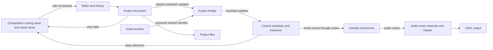

# StateMachine implementation plan

Build toward the [project vision](VISION.md): main score → auxiliary scores and transformations → control routing → instruments → audio mixer. A composed drum pattern should remain editable while its live references are chopped and rearranged. Tracks represent control; instruments produce audio that is combined through separate mixer channels. Establish these distinctions in the project model and editor before expanding the prototype's current sample-clip representation.

Preserve the custom rendering stack, implement undo, replace text rendering with glyphon, use Symphonia and Rubato for audio import and sample-rate conversion, and add sample organization and waveform displays. Address the correctness and performance findings from the code review along the way. The vision remains exploratory, so test the central control-sampling idea with a small audible example before committing to a large graph framework or a fixed tab layout.

The [design references](design/README.md) record visual directions for later exploration, including interest in shaders and effects. Detailed visual design is deferred. The renderer should leave room for those experiments without making them a prerequisite for the core editor.

Each phase should leave a runnable application. Keep changes in small commits that separate behavior changes from dependency migrations. Regression tests should express the intended behavior and land with the relevant fixes.

The Rust toolchain update to 1.99.1 is complete and pinned in `rust-toolchain.toml`; `Cargo.lock` is tracked. The first implementation batch establishes a library/test entry point, formatting and macOS CI, and the phase 1 stabilization changes. Phase 2 now provides an independent project model, validation, and a headless control-score evaluator; its initial semantics and migration boundary are recorded in [MODEL.md](MODEL.md). The current demo reads a temporary frame-based document through a compatibility session. The new editor, scheduler, and dependency migrations remain subsequent work. See [development and validation notes](DEVELOPMENT.md) for regression coverage, the measured release reference, and remaining manual checks. Rendering performance recommendations remain hypotheses to measure, rather than promised speedups.

**The recommended order establishes correctness, then editing boundaries, then replaces infrastructure and adds visualization.**

| Phase | Result | Why it comes here |
| --- | --- | --- |
| 0 | Reproducible build and validation baseline | Makes later failures attributable to individual changes. |
| 1 | Immediate crashes and data corruption addressed | Protects the reference application during refactoring. |
| 2 | Control-oriented model with sources, placements, instruments, and a separate mixer | Makes composition and sound production independent. |
| 3 | Undoable event, placement, routing, and mixer edits | Proves the editor boundaries through the intended interactions. |
| 4 | Editable auxiliary scores driving samplers and a basic mixer | Proves live control sampling while establishing bounded realtime scheduling and ownership. |
| 5 | Symphonia import, Rubato conversion, and sample catalog | Gives instruments, sample organization, and visualizations a consistent asset representation. |
| 6 | Project saving and loading | Makes work durable once the model and asset references are established. |
| 7 | Custom rendering with glyphon and coordinated composition, routing/mixing, and asset views | Presents the separate layers through a shared editor while leaving tab layout flexible. |
| 8 | Live instrument/output waveforms and cached sample waveforms | Visualizes audio while control sequences retain their event representation. |
| 9 | Performance measurements and final cleanup | Optimizes the resulting design using representative workloads. |

The rendering migration within phase 7 primarily depends on phases 1–3 and can move earlier if compatibility with the old graphics stack becomes a development blocker. Its instrument, mixer, and sample-manager views also depend on phases 4–5. The recommended sequence otherwise avoids mixing audio and graphics migrations in the same change.

The first complete architectural experiment spans phases 2–4: write a drum pattern in an auxiliary score, arrange chopped or retimed references from the main score, and route their events to sample instruments feeding a basic mixer. Edit a source hit and confirm that its affected uses update without freezing to audio or manually rebuilding copied events. Launching the same source twice must allow independent playback state. Use the existing sample bank and a minimal interface; polished routing/mixer and asset views follow after the model proves useful.

**The target architecture keeps document editing on the main thread and playback state on the audio thread.**

| Module | Responsibility | Important boundary |
| --- | --- | --- |
| `model` | Designated score, control sequences/events, placements and transforms, instrument definitions, control routes, mixer configuration, audio routes, and sample references | No window, graphics, device, or thread-channel dependencies. |
| `editor` | Validated edits, transactions, undo/redo, document revision, and save status | Changes the project through a small explicit API. |
| `engine` | Control scheduling, running sequence instances, prepared routing, and engine communication | Evaluates control and dispatches sample-timed events with bounded realtime work. |
| `instruments` | Instrument interfaces, the initial sampler, and voice state | Consumes supported control events and produces audio independently of track layout. |
| `audio` | Mixing, output conversion, metering taps, and CPAL device integration | Realtime processing does bounded work without allocation, deallocation, locks, or I/O. |
| `assets` | Sample catalog, decoding, resampling, immutable sample storage, and waveform caches | Expensive work and resource destruction happen outside the audio callback. |
| `ui` | Interaction state, selection, layout, hit testing, drawing preparation, and custom GPU rendering | Reads the project and submits editor commands. Geometry is derived data. |
| `persistence` | Versioned project files and asset-reference resolution | Saves document data independently of runtime and GPU state. |
| `app` | Startup, subsystem wiring, job completion, and event-loop integration | Coordinates the other modules. |

Start with modules in one crate and expose a library target for tests. Rename the current top-level `Instrument` to the application coordinator so the instrument concept can describe sound-producing modules. Move editor-facing data out of `SequencerInterface`, and keep the scheduler and audio engine independent of UI modules. A reusable sequence, its placement, and a running playback instance need separate identities even if a control track and its sequence definition initially share one representation.

**Phase 0 establishes a reproducible baseline.**

- Keep the existing tracked `Cargo.lock` and `.gitignore` policy. Pin the tested compiler in `rust-toolchain.toml`; establish a minimum supported Rust version only when it has actually been tested.
- Document build/run commands, demo interactions, and the expected four-sample starting project. Note the current local workaround, `DEVELOPER_DIR=/Library/Developer/CommandLineTools`, for the Xcode license issue without changing the machine's global developer-tool selection.
- Add a library/test entry point and a small device-independent control/audio harness. Preserve the review's reproduction cases as the starting regression backlog, changing their assertions to expect corrected behavior when their fixes land.
- Establish formatting and compiler/Clippy baselines. Separate mechanical formatting from functional changes. Add CI for the primary macOS build and pure logic tests; expand platform coverage deliberately as native dependency setup is validated.
- Capture a release-build reference: idle redraw frequency and CPU usage, playback behavior, and a few reference images of the current UI. Record workload, window size, and device with measurements.

Completion: a fresh checkout has repeatable build instructions and a locked dependency graph; CI runs the initial checks; the baseline demo behavior is documented.

Status: build instructions, toolchain pin, library/test harness, formatting, local compiler/Clippy checks, and CI configuration are implemented. A release idle measurement is recorded. Hosted CI, reference screenshots, and interactive playback/minimize checks remain unverified.

**Phase 1 fixes the small, reproducible failures on the existing stack.**

- Make audio status publication tolerate a full queue. Dropping an old status update must never panic playback. Audit every queue `unwrap`; control edits need an explicit pending/retry or rejection policy so the UI and engine cannot silently diverge.
- Validate clip, junction, channel, and sound-bank indices and capacities before mutation. The 33rd junction and a full sound bank should produce a controlled result. Fix cross-channel junction creation so the source track owns the junction and the destination remains its target.
- Correct the interpolator's source advancement for downsampling and validate finite, positive ratios. Cover identity conversion, upsampling, downsampling, empty input, short input, and output duration. This is a narrow bridge fix until Rubato replaces import conversion in phase 5.
- Return errors from sample loading instead of panicking. Until phase 5, explicitly reject unsupported channel layouts or bit depths rather than misinterpreting stereo or panicking on 24-bit data. Keep the bundled mono 16-bit files working.
- Add reusable CPU instance staging and growable GPU buffers for rectangles and lines. Upload each populated batch in bulk. This fixes the unchecked 128-instance limit and provides the batching mechanism that survives the graphics migration.
- Handle recoverable surface acquisition errors and suspend drawing at zero window size. Make skipped frames discard their pending drawing state, so instance counts and text queues cannot leak into the next frame.

Completion: regression tests cover queue saturation, bounds failures, junction ownership, and downsampling. A stress scene can exceed 128 shapes. Resizing/minimizing/restoring the window does not panic or duplicate drawing state.

Status: stabilization code and regression coverage are implemented. Junction ownership was already corrected in the starting checkout and is now covered by a test. GPU pixel-readback and the window stress example pass locally; the example exercises resize and zero-size suspension. Actual OS minimize/restore and forced surface-loss/timeout recovery remain unverified. The sample loader intentionally rejects stereo and unsupported bit depths until phase 5.

**Phase 2 models control material, instruments, and routing independently.**

- Introduce a project with one designated main score, reusable auxiliary control scores, typed events, sequence placements, instrument definitions, control routes, mixer channels/audio routes, and sample references. Control tracks edit/present sequences; their identities and count are independent of instruments and mixer channels.
- Start with explicit event kinds for instrument triggers, launching/stopping auxiliary material, and simple parameter changes. Preserve useful junction behaviors as control operations. Validate destinations and port/event compatibility; keep sequence-reference dependencies distinct from control-routing connections and audio mixing.
- Introduce stable typed IDs for sequences, events, placements, instruments, control routes, mixer channels/audio routes, and samples. Reordering storage preserves references, and undoing deletion restores original identities. Engine slots and runtime instance IDs remain separate from document IDs. Control-event connections and audio connections must validate against different port types even if they share a UI tab.
- Separate a reusable source from its placements and running instances. A placement references a source region and timing transform. Source edits propagate to the affected uses, including events entering/leaving a slice, while a placement edit affects one use. Prepared event schedules are invalidatable caches of these references. Do not make one global playhead per source or the current first-overlapping-clip rule a permanent model constraint.
- Use distinct control time, source audio frames, and device frames, with explicit conversion between local sequence time, score time, and sample offsets. Choose and document the initial canonical control unit for the first fixture before committing the file schema; use a single tempo mapping initially if musical ticks are chosen. Device-rate changes must preserve composition timing. The old frame-based timeline can remain a compatibility representation during migration.
- Implement a pure event-evaluation prototype for source-region selection, offset, and timing scale, then explicit repetition. Define boundary inclusion, event duration handling, simultaneous ordering, and composed transforms. Keep control timing rate distinct from an instrument's audio playback rate. Record reverse/sustained-event policies before extending the transform set.
- Separate project metadata, UI interaction state, runtime state, and decoded assets. Replace cached `ClipInterface.model` copies with project views and explicit cache invalidation. Adapt the demo's simple sample behavior while the new control model develops; expose model validation and event evaluation without a window or audio device.

Completion: headless fixtures show a main score referencing an editable auxiliary drum score, selecting/retiming its events, and resolving them to an instrument destination and audio output path. Tests cover stable references, route type errors, local-to-score timing, source edits updating affected slices, and the difference between source edits and placement edits.

Status: the phase 2 headless model and fixture are implemented in `src/model`, with typed IDs, 960-tick musical time, exact composed transforms, validation, and explicit evaluation limits. `cargo run --example control_score` demonstrates source edits propagating through chopped/repeated placements. Sixteen model tests cover the completion criteria and failure cases. The coordinator is renamed to `App`; old clip/junction data and queue publication now live in `PrototypeSession`, and UI geometry is derived from document reads. The windowed demo still uses its original frame-based engine; the new model is not yet the interactive document. Launch/stop events are represented and validated, but runtime execution, sustained/reversed events, and audible mixing remain phase 4. See [model semantics](MODEL.md) before extending these operations.

**Phase 3 introduces the editor and proves it with control editing.**

- Add `Editor::execute`, `undo`, and `redo`. Begin by moving a sample-trigger event within or between control tracks, recording its stable ID and before/after owner and time. Validate edits before applying them; all successful paths use the same project-update and engine-notification route.
- Make a drag a transaction: remember the original state on press, preview movement, commit one undo entry on release, and restore without a history entry on Escape. Support different event types with validated drop targets. Coalesce replaceable playback previews as well as history entries.
- Extend the mechanism to event insertion/deletion, sequence placements and transforms, junction/control operations, instrument assignments, control/audio connections, and mixer settings. Make source edits and placement edits explicit operations. A compound edit must undo atomically, including restoring dependent routes, references, and identities. A mixer fader gesture produces one history entry using the same transaction policy as a timeline drag.
- Clear redo after a new edit branches from an undone state. Set a history memory budget and retain referenced assets while history needs them. Track the identity of the saved history state for accurate dirty status, including after undo and branching.
- Keep playback progress, telemetry, hovering, ordinary selection changes, and meter readings outside document history. Mixer settings are document edits. Preserve current transport state when undo updates the project during playback.
- Consolidate input dispatch so the actual event and transformed pointer position reach the correct panel. Restrict timeline edits to its bounds; finish or cancel gestures consistently when pointer capture, focus, or window state changes. Replace the currently disconnected generic input/state paths with the working explicit route.

Completion: a drag with many mouse events produces one undo step; Escape cancels it; moving an event between control tracks preserves its identity; undo restores placements, source data, and routes; edits during playback reach the engine; no input action directly mutates runtime state.

**Phase 4 makes editable control material drive sample instruments and a mixer.**

- Expose block processing through a device-independent engine, with CPAL as an adapter. Keep junction and event timing sample-accurate inside each block. Bound the amount of control work processed per callback so an edit flood cannot consume the audio deadline.
- Prepare validated control schedules and routes outside the callback. Evaluate the score and auxiliary sequence instances, transform their event times, and dispatch them at sample offsets to instrument inputs. Multiple launches of one source get independent execution state. Allow several control sources to address an instrument and a control output to route to multiple compatible destinations.
- Implement a small sampler over the existing prepared sample bank with preallocated voices and an explicit retrigger/voice-limit policy. Associate triggered voices with their owning runtime instances so stop, seek, deletion, or a failed execution can release the appropriate voices. Keep instrument state independent of the control view's rows.
- Route instrument audio through a basic mixer with stable channel assignments and a master output. Begin with gain, pan/balance appropriate to channel layout, mute/solo, and bounded meter publication. Define smoothing for level changes. Keep bus/send/effect expansion behind the audio-routing boundary so the first experiment stays small.
- Define launch/stop behavior, child-instance lifetime, and simultaneous event ordering. Initially reject unsupported recursive sequence launches and routing feedback; allow explicit time-advancing loops without expanding them indefinitely. Bound nesting, active instances, events, and route fan-out; report limit violations through telemetry and clean up affected voices without blocking or allocating.
- Apply related document changes atomically at a defined processing boundary. Give updates a document revision and publish the last applied revision. Use prepared updates or snapshots for larger changes; preserve runtime state for unchanged instances and instruments, and explicitly release state whose owners or routes are removed.
- Propagate source-pattern edits through dependent placements and prepared schedules at that boundary. Test changing a drum hit's timing or velocity during playback and switching its sample instrument while preserving the chopped arrangement. Define which in-flight voices finish or release, and prevent duplicated or stale triggers when schedules change.
- Separate reliable edits and transport commands from replaceable previews and lossy telemetry. Keep pending edits outside the callback when a queue fills. Coalesce only operations whose intermediate values are disposable; a dropped insertion or transport command must never be mistaken for success.
- Define resource transfer and retirement explicitly. Prepare sample data and playback structures outside the callback, then transfer handles. Return retired resources to a worker for destruction. If retirement capacity is unavailable, defer a replacement rather than freeing data on the audio thread. Cover shutdown and stream-error cleanup too.
- Upgrade CPAL and `rtrb` in focused commits while preserving this contract. Store the selected device and its negotiated configuration together. Validate channel routing, define mono output downmixing, and report unavailable or disconnected devices without an application-wide panic.
- Keep internal audio in a consistent floating-point representation and convert at the device boundary. Retain allocation/deallocation checks for the callback and add controlled tests for repeated edits, replacement, and queue pressure.

Completion: the main score arranges selected/retimed or repeated regions of an editable auxiliary drum score; routed events drive samplers whose outputs reach mixer channels and the master. Source and instrument edits update the result without a freeze/bounce step or rebuilding the arrangement. Repeated launches have independent positions. Tests verify event timing, schedule revision changes, fan-out, stop/release cleanup, mixer behavior, and rejection of unsupported cycles. UI stalls do not stop audio; resource replacement does not allocate or free in the callback.

**Phase 5 establishes the sample catalog and replaces instrument audio conversion.**

- Add a worker-based asset pipeline using Symphonia. Start with correct WAV/PCM/float decoding, then enable the selected additional formats through its codec/container features. Preserve stereo, duplicate mono deliberately, and reject additional channel layouts until a downmix policy is implemented. Symphonia documents its supported formats and feature gates in its [crate documentation](https://docs.rs/symphonia/latest/symphonia/).
- Convert decoded samples into the canonical float representation with correct bit-depth normalization. Handle malformed files, truncated files, missing files, and unsupported formats as recoverable errors. Route demo sample loading through this same pipeline.
- Add a project-local sample catalog with stable asset IDs, display names, source references, metadata, and simple virtual collections or tags. Keep organization separate from decoded buffers and instrument assignments. Provide editor commands for catalog metadata and assignment; build the richer sample-manager view in phase 7.
- Use Rubato for import sample-rate conversion and source-to-engine or engine-to-device conversion where needed, keeping these audio rates distinct from control time. Prepare resamplers and buffers outside realtime processing and use APIs that reuse buffers. Account for output length, resampler delay, and tail flushing; add a meaningful anti-aliasing test. [Rubato](https://docs.rs/rubato/latest/rubato/) provides filtered conversion and supports both offline and realtime use with the appropriate processing path.
- Implement the existing `source_shift` and `source_scale` intent as sampler source offset and audio playback rate under the phase 2 timing policy. At an audio rate of 0.5, a sample plays at half speed with a corresponding pitch change. A control sequence running at 0.5 instead retimes triggers and does not implicitly alter the sample's pitch. Preserve fractional sample positions, define source-region ends and reversal, and avoid applying device conversion or playback-rate ratios twice.
- Add master gain, an overload indication, and a documented output policy. Recommended first policy: float summation, adjustable master gain, and a final safety clamp before device conversion. Verify mono/stereo routing and overlapping-channel peaks. Any later musical limiter can replace that final protection stage explicitly.
- Give loading jobs identities so stale or cancelled completions cannot modify a newer project or resurrect an undone import. Keep sample references alive across editor history and active engine use, with final release outside the callback.
- Add an engine-owned audition path for previewing assets and auxiliary control material independently of the main score, with explicit stop and cleanup. Preview commands do not silently create project events or history entries.
- Remove the old importer and import interpolator after replacement tests pass. Remove unused production dependencies; retain Hound only if it still serves WAV writing or fixture creation.

Completion: fixtures cover mono/stereo, 16/24/32-bit PCM and float where supported, mismatched rates, malformed files, and sampler offset/rate playback. Tests distinguish retimed control from changed audio playback rate. Catalog organization and instrument assignments retain asset identity; loading and auditioning keep the UI and main score responsive. Output duration, delay compensation, and amplitude are checked numerically.

**Phase 6 makes projects durable.**

- Define a versioned project file containing the designated score, control sources, placements/transforms, typed events, instrument definitions, control routes, mixer settings/audio routes, sample catalog, stable IDs, and the chosen control timebase. Keep decoded buffers, render caches, active execution state, meter values, and undo history separate from the composition file.
- Resolve asset paths relative to the project where practical and retain enough identity/metadata to detect missing or changed assets. Report missing files with a relink path through the UI.
- Save through a temporary file and replacement so a failed write preserves the previous project. Associate the saved marker with the document revision actually written, even if editing continues during the save.
- Load and validate into a separate candidate project, prepare its assets/playback data, then switch the editor and engine coherently. An invalid file leaves the current project usable.
- Add save/open commands and keyboard shortcuts through the same application command path used by other input. Keep editor transaction handling consistent when opening or replacing a project.

Completion: a project round-trip preserves shared source references, independent placements, timing transforms, control/audio routes, mixer settings, sample organization, and identities. Missing assets and failed writes are recoverable; dirty status remains correct through edits, save, undo, redo, and branching.

**Phase 7 modernizes rendering and presents the composition layers separately.**

- Choose a compatible released set of `wgpu`, `winit`, and `glyphon` from their actual dependency requirements. Record the selected versions in the lockfile. Keep any major-version bridging work within this migration and validate one coherent combination before proceeding.
- Migrate window/event handling to winit's supported application lifecycle, including resize, scale changes, focus, suspension, and redraw requests. Its current [application interface](https://docs.rs/winit/latest/winit/) uses `ApplicationHandler` and `run_app`.
- Replace `wgpu_glyph` and the direct `glyph_brush` measurement path with glyphon. Retain font-system and glyph caches across frames. Use actual shaped text metrics for layout and make positioning, scaling, and clipping agree with other primitives.
- Separate draw collection, resource preparation, and GPU encoding. Reuse CPU vectors and the growable instance buffers from phase 1; batch compatible uploads and draw calls without changing visible ordering. Cull offscreen timeline content and clip each panel.
- Keep colors, typography, surface styling, and optional effect parameters separate from project semantics and interaction logic. Preserve a plain UI rendering path while leaving room for optional material shaders and offscreen/postprocessing passes. The combined base UI pass is a baseline, not a restriction on later visual effects. Use the design references for later experiments without selecting a visual style during this migration.
- Prepare text before opening the render pass. Draw shapes and glyphs into the same multisampled color target, then resolve to the surface at the end of that pass. Glyphon's [text renderer](https://docs.rs/glyphon/latest/glyphon/struct.TextRenderer.html) accepts an existing render pass. Remove the old text-only and resolve-only passes when visual tests confirm equivalent output. Discard attachments whose contents are no longer needed.
- Define explicit layer and tie-order semantics. Ensure the bottom layer is drawable, overlapping equal-layer items behave consistently, and separators, playheads, text, and overlays have intentional priorities. Support alpha blending where needed; batching must respect the ordering required by transparency. Retain or remove the depth attachment based on this policy rather than merely changing the comparison function.
- Fix nested transform composition and unify coordinate conversions for geometry, text, and hit testing. Cover non-unit scales, translations, panel clipping, and high-DPI resizing.
- Build coordinated control/score, instrumentation/routing, traditional mixer, and sample-manager views. Prototype a shared sound-production tab with routing/instrument controls above mixer strips; keep separate tabs as an alternative to compare through use. All views share the project, editor history, and command path. The control view exposes reusable sources, placements, and event drag/drop; routing exposes typed destinations and sampler configuration; mixer strips expose levels, pan/balance, mute/solo, meters, and master output; assets expose import, browse/filter, organize, preview, assign, and relink actions.
- Distinguish editing shared source material from editing one placement. Display independent running-instance positions without assuming a single playhead per reusable source. Keep control connections visually distinct from audio output/mixing even when they share a tab, and use selection to reveal an instrument's control sources and mixer destination. Preserve playback and editing state across view switches; refine the exact layout through the editable drum-slicing experiment.
- Redraw when idle content changes and at a controlled cadence while playback or visualization is active. Disable unnecessary redraws when hidden. Make the diagnostic frame counter opt-in or rate-limited so it cannot force continuous idle updates. Continue processing engine status and job completion even when no frame needs drawing.

Completion: visual checks cover layers, alpha, text metrics, nested transforms, clipping, DPI, and surface recovery. The default scene uses one combined drawing/resolve pass where supported by the selected integration. Control editing, routing, mixer settings, and sample organization use one undo history; view switches preserve playback. The routing/mixer layout has been tried against the editable drum-slicing example. A large control timeline renders without fixed-capacity errors; idle redraw counts fall without making controls or telemetry stale.

**Phase 8 adds audio waveforms without conflating them with control material.**

- Tap the application's final mixed output after master processing and output protection, with a documented relationship to device channel mapping. Keep visualization separate from the engine's editable model.
- Expose selected instrument output taps through the same bounded telemetry mechanism when useful. Show waveform views with instruments, output monitoring, and sample assets. Represent reusable control sequences through their events and transformations rather than pretending they contain PCM audio.
- Accumulate per-channel minimum and maximum values over short fixed intervals, carrying incomplete bins across audio callbacks. Include an engine sample position or sequence number and enough information to handle sample-rate changes.
- Publish fixed-size records into a dedicated, preallocated `rtrb` queue. At 48 kHz, 48 frames per bin gives 1,000 bins per second; a timestamp plus stereo min/max values is approximately 24 kB/s. A full queue drops the visualization record without blocking, allocating, logging, or panicking.
- Keep a bounded history on the UI thread, consume with a per-frame work limit, discard stale data, and preserve visible gaps when samples were dropped. Merge min/max bins to match the current pixel width, then render batched vertical segments or filled spans. Keep channels separate by default to avoid phase cancellation.
- Build sample peak caches from imported audio on a worker. Store multiple resolutions and select the appropriate level for the zoom. Sample-region displays use the sampler's offset, rate, and reverse mapping consistently with playback and do not pass through the live audio telemetry queue. Control-sequence previews use event/time data independently of these audio caches.
- If a short oscilloscope view is useful, add a preallocated latest-snapshot channel for a small raw-sample block. A [triple buffer](https://docs.rs/triple_buffer/latest/triple_buffer/) is suitable for publishing the latest complete snapshot; scrolling waveform history still uses the ordered bin stream.

Completion: tests cover silence, impulses, stereo phase differences, overloads, callback boundaries, and dropped records. Pausing UI consumption leaves audio unaffected; resuming displays current data with honest gaps. Sample-region waveforms align with sampler playback, while control-sequence timing remains an independent representation.

**Phase 9 measures the finished design and closes the maintenance backlog.**

- Profile release builds with repeatable scenes: idle/stopped, normal playback, editing during playback, nested/repeated control sources, concurrent instances, route fan-out, view switching, waveform display, resize, and concurrent sample import. Record CPU frame preparation, GPU time where available, callback duration relative to its deadline, upload bytes, draw/pass counts, active instances/voices, and queue-drop counters.
- Compare 1x and 4x MSAA visually and quantitatively. Keep antialiasing quality that earns its measured cost. Investigate clipping/culling, control-event indexing, scheduling, or further batching only where the profile identifies a useful improvement.
- Once the core workflow is usable, try small visual/shader studies against the design references, such as grain, glow, textured glass, or animated lighting. Compare each with the plain rendering baseline for appearance, legibility, motion, and GPU cost. Additional passes are acceptable when they serve a chosen effect. Schedule redraws while an enabled effect is animated and allow the idle path when it is static or disabled.
- Test long-running playback, stream replacement, project switching, large undo histories, and asset retirement for unbounded memory growth and callback allocation/deallocation.
- Remove abandoned input/component scaffolding and remaining accidental warnings once the working replacements are established. Resolve dependency compatibility warnings, including the old `block` dependency where the migrated graph permits it. Retain meaningful extension points with clear ownership and tests.
- Update the vision's open decisions as experiments resolve them. Document control/instance lifetime, routing and cycle rules, supported input formats, control-versus-audio rate semantics, layer ordering, keyboard actions, and measured limits. Make CI enforce the resulting formatting, tests, and agreed lint policy.

Completion: representative workloads have recorded results, idle rendering is demand-driven, audio timing and memory use remain bounded, and the repository documents the actual implemented boundaries.

**The next implementation change should introduce the editor and undo history.**

The baseline, stabilization, and headless project-model batches are implemented with the verification limits noted above. Next, give the new `Project` a validated editor boundary and prove an undoable event move within and between sequences while preserving its ID. Keep the ID allocator outside history snapshots, establish revisions and transaction behavior, and then connect the editor to the composition interface. The phase 4 engine will make the score-to-transformed-sequence-to-sampler example audible. Keep the original demo's compatibility session until its replacement can preserve the required interactions; dependency migrations and visual design remain later work.
