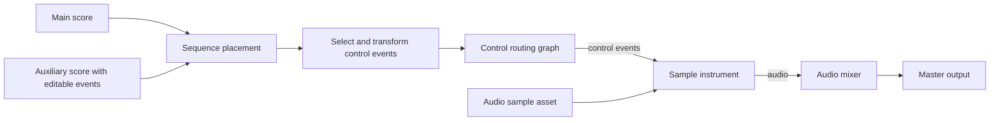

# StateMachine project vision

StateMachine is a modular application for creating interesting compositions with samples. The central experiment is to make control material reusable and transformable in the way recorded audio can be sampled: a melody, rhythm, or sequence of triggers can be selected, chopped, rearranged, looped, and retimed before it drives an instrument.

The intended flow is **main score → auxiliary scores and their transformations → control routing → instruments → audio mixer**. An auxiliary score is reusable control material; the main score arranges and launches uses of that material. The main score can also contain direct events. Instruments turn the resulting control into sound, and a traditional mixer interface handles the resulting audio channels and output.

This is a working vision. The architecture should make these ideas easy to try and revise. The [implementation plan](IMPLEMENTATION_PLAN.md) describes the next steps; this document distinguishes the product direction from proposed representations and unresolved musical behavior.

**Tracks represent control.**

There is one designated main control track: the score. It orchestrates a composition by triggering events. Events may cause samples to play, launch auxiliary control tracks or sequences, or perform other actions as the system develops. Auxiliary control material can itself trigger further activity.

An instrument interprets control and produces sound. The initial instrument is a sample player. A control track does not inherently own an audio output, a sample buffer, or exactly one instrument. Routing can let a sequence drive different instruments and let several control sources address the same instrument.

Mixer channels represent audio paths from instruments or buses. Their identities and count are independent of control tracks. Control routing answers which events reach which instrument; audio routing and mixing answer where an instrument's output goes and how it is combined with other sound.

The current prototype is an experiment in this direction. Its rows, clips, and junctions should inform the next implementation without fixing the permanent model to the shape of conventional audio tracks. Dragging different kinds of event triggers from one control track to another remains an important interaction to explore.

**Control sequences should be usable as source material.**

Consider a melody stored as a reusable sequence of musical events. The score can place a reference to its middle section, repeat that section, or play it with a different timing transformation. The resulting events travel through a control-routing graph to a sample instrument. Changing the instrument can change the sound while preserving the transformed melody.

The transformation operates on structured control data. Rendering the melody to an audio file may eventually be useful, but the core experiment preserves the events so that their timing, destinations, and interpretation can still change.

A concrete creative test is to write a drum pattern as MIDI-like trigger events in an auxiliary score, then select beats or smaller regions and rearrange or repeat them from the main score. The source pattern remains editable throughout. Changing a snare hit's velocity or timing updates the transformed uses whose selected regions contain that event. Changing the receiving sample instrument changes the sound while preserving the arrangement. This workflow should work directly on live references without requiring a freeze/bounce step or manually rebuilding every chopped copy. Editing a source region can intentionally add or remove events from a slice as they cross its boundaries.

A control timing transformation and an audio playback transformation are separate concepts. Slowing a control sequence changes when its events occur and, under a chosen policy, their durations. It need not change the pitch or playback speed of the samples those events trigger. Sample start offsets, audio playback rate, and audio reversal belong to the instrument/sample layer.

**The first model should distinguish sources, placements, and running instances.**

These are proposed concepts to test, rather than final Rust type names:

| Concept | Meaning |
| --- | --- |
| Project | A document containing the designated score, reusable control material, instrument definitions, control routes, mixer configuration, audio routes, and sample references. |
| Control sequence | A named timeline of structured events and references to other sequences. A control track presents and edits this material. The first implementation may use one type for a track's timeline and its reusable sequence definition. |
| Control event | A timed action such as an instrument trigger, sequence launch/stop, or parameter change. Event kinds have explicit payloads and supported destinations. |
| Sequence placement | A reference to a source sequence with a source region, placement time, and timing transformations. Several placements can reuse the same source. |
| Playback instance | One running evaluation of a sequence or placement, with its own position and execution state. Triggering a source twice can create two independent instances. |
| Instrument | A module that consumes supported control events and produces audio. The initial sampler references audio assets and manages its own voices. |
| Route | An explicit connection between compatible control outputs and inputs. Control routing and audio mixing have distinct semantics. |
| Mixer channel or bus | An audio path with level, pan/balance, mute/solo, metering, and an output destination as supported by its channel configuration. It is independent of a control track. |
| Sample asset | Audio data and its metadata, file references, and derived waveform caches, managed independently of control sequences. |

Editing a shared source and editing one placement must be distinguishable operations. A source edit can affect every placement that references it; changing a placement's source region or timing affects that placement. Running instances have separate identities so repeated triggers do not overwrite a single shared playhead.

Use explicit event kinds, instrument kinds, and validated connections for the first experiment. Modular ownership and narrow interfaces provide room to add capabilities. A general plugin system or user-programmable graph language can be considered if experiments establish a need for one.

**The interface should expose composition, sound production, mixing, and assets clearly.**

The likely organization is:

- A score/control view for the main score, auxiliary sequences, event triggers, sequence placements, and transformations. It should make it easy to drag events between tracks and distinguish editing a source from editing a placement.
- An instrumentation/routing view for assigning control to instruments and configuring sample players. Graph connections should make event destinations understandable.
- A traditional mixer view with audio channel strips and a master output. Start with gain, pan/balance, mute/solo, and meters; refine grouping, buses, and sends as the musical experiments require them.
- A sample manager/organizer view for importing, browsing, naming, organizing, previewing, and relinking sample assets, then assigning them to instruments.

Routing, instrument configuration, and mixing may share a tab, for example with a control-routing area above audio channel strips. This is a UI experiment, not a requirement that control events and audio connections share one graph representation. The exact navigation and tab count remain open. These are coordinated views of the same project and editor, with shared identities, selections where useful, and one coherent undo history. Switching views does not stop playback. The score remains the designated composition entry point; auxiliary material can be auditioned separately.

Sample previews should go through the audio engine using an explicit audition route, so auditioning does not silently add events to the score. The first organizer can work within a project; a separate library shared across projects remains a later product choice.

The custom WGPU renderer remains the intended rendering foundation, with glyphon planned for text. Symphonia and Rubato remain the planned decoding and sample-rate conversion libraries. These infrastructure choices support the composition experiment described here.

**The next architectural milestone should make the central experiment audible.**

After stabilizing the prototype, build one complete example:

1. Write a short drum pattern as editable trigger events in an auxiliary score.
2. Have the main score arrange placements selecting different regions of that pattern.
3. Change a placement's timing or repeat a region while retaining its reference to the source.
4. Route the resulting events to sample instruments and hear their audio through mixer channels and a master output.
5. Change a hit in the source pattern and confirm that the relevant transformed uses update; change a receiving sample without rebuilding the arrangement.
6. Launch the same source again with independent playback state.
7. Move an event or placement, change a route or mixer level, and undo the edit without rewinding the transport.

The initial sample bank and a minimal interface are enough for this example. Use it to evaluate the model before investing in a polished graph editor or a large collection of transformation types.

**Musical semantics that need experiments should stay explicit.**

- **Time:** whether the primary authoring unit is beats/ticks, absolute time, or both; how tempo changes interact with nested timing transformations. Control time must remain distinct from source audio frames and device frames.
- **Slices and reversal:** what happens to a sustained event that begins before a selected region, ends after it, or crosses a reverse/loop boundary. Event durations, onset/release pairing, and parameter state need defined rules; reversing a list alone does not establish those rules.
- **Launching:** retrigger versus independent instances, stop behavior, whether the caller's end stops descendants, and how parameters and routes are inherited or overridden per placement.
- **Recursion and feedback:** how sequences may trigger themselves or each other, and whether routing feedback is musically useful. The first scheduler should allow explicit time-advancing repetition while rejecting unsupported recursive launches and zero-delay cycles. Set execution limits and define cleanup so a malformed experiment cannot hang the audio callback or leave stuck voices.
- **Event ordering:** deterministic handling of simultaneous triggers, stop/release events, parameter changes, and multiple sources driving the same destination.
- **Shared material:** how the UI distinguishes a source edit, an instance edit, and making an independent copy; how deleting referenced material or editing it during playback behaves.
- **Control signals:** whether continuous automation or modulation should eventually accompany discrete events, and what interfaces can accommodate it without forcing audio buffers and control data into one representation.
- **Organization:** whether routing, instruments, and the mixer share a tab; how selecting an instrument highlights its control sources and audio destinations; whether the sample organizer becomes a project-independent library; and which instrument or transformation modules prove useful first.

Resolve the minimum semantics needed for each experiment, record the chosen behavior with tests, and keep the versioned project format aligned with those decisions.
